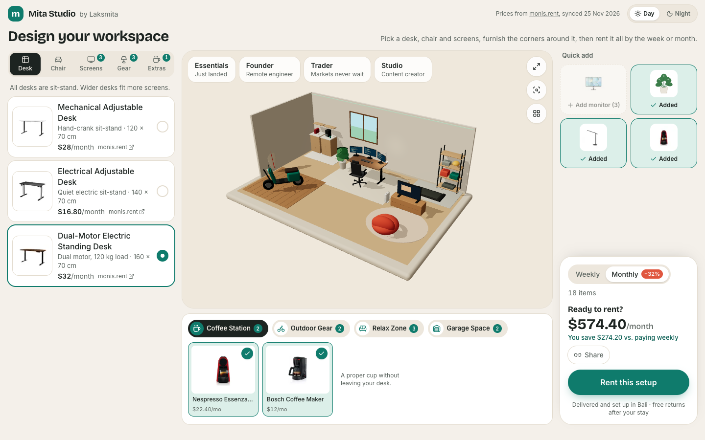
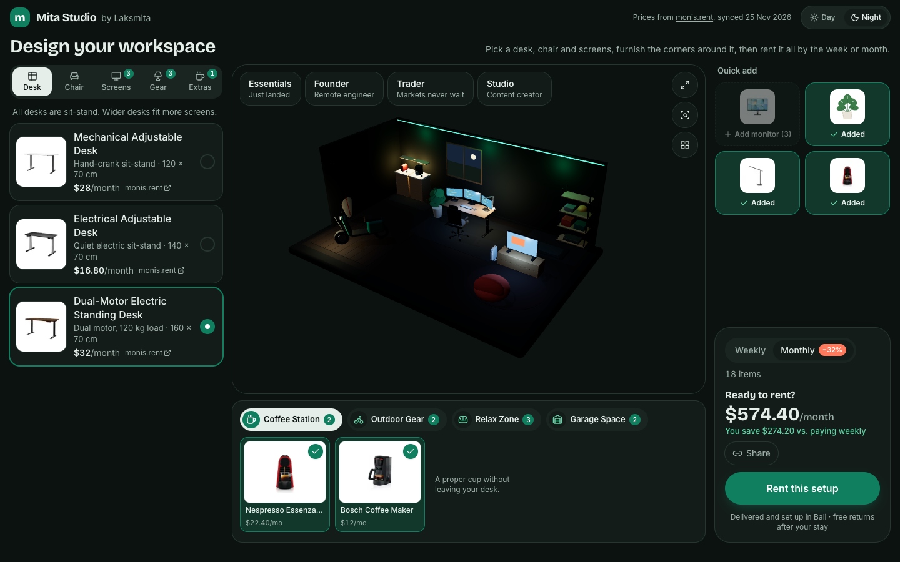
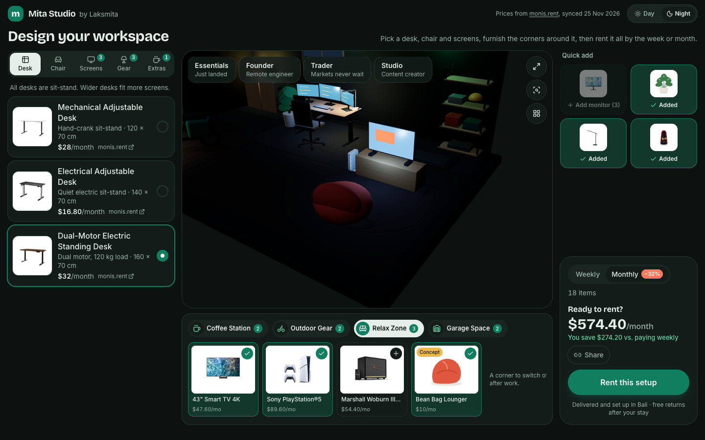
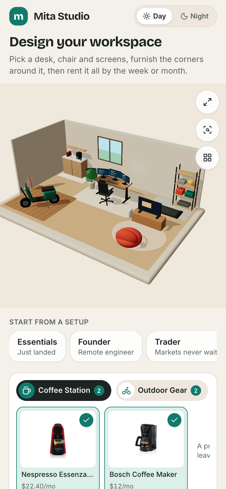

# Mita Studio · design your Bali workspace

**Live preview → [mita-studio-theta.vercel.app](https://mita-studio-theta.vercel.app/)**

Build a remote-work setup in a 3D villa room, furnish the corners around it, and rent the whole thing from [monis.rent](https://monis.rent) by the week or month. Designed and built by **Laksmita**.



## At a glance

- **Live:** [mita-studio-theta.vercel.app](https://mita-studio-theta.vercel.app/)
- **Code:** [github.com/laksmitawidya/mita-studio](https://github.com/laksmitawidya/mita-studio)
- **Built with:** Next.js 16, Tailwind CSS 4 and three.js, deployed on Vercel
- **What's inside:** 3 desks, 2 chairs, up to 3 screens, desk gear and 13 items across four zones, all in a live 3D room, with a checkout at the end

## Try it

1. **Start from a setup.** Essentials, Founder, Trader and Studio are starting points based on who rents from monis.rent.
2. **Pick a desk, chair and screens.** Desks are drawn to scale, so a 160 cm desk really does fit three monitors and a 120 cm desk doesn't.
3. **Furnish the corners.** The bar under the room works like a life-sim build mode. Pick *Coffee Station*, *Outdoor Gear*, *Relax Zone* or *Garage Space*, and the camera glides to that corner while you drop items in.
4. **Switch to Night.** The room is lit only by what you rented: glowing screens, desk lamps, the TV, the scooter's headlight and a cove LED.
5. **Rent it.** Choose weekly or monthly (you see what monthly saves), how long, and where in Bali. Then send the request.

Every change updates the URL, so a setup is easy to share. For example, [this full villa](https://mita-studio-theta.vercel.app/?setup=D3.C1.M24.M27.M24.KB.MS.L1.PL.CF.BC.SB.MB.TV.BB.PS.TS.WP&plan=month) is one link.

| Night mode | Zone close-up | Phone |
|---|---|---|
|  |  |  |

## Features

- **Live 3D room** (react-three-fiber). Items drop in with a spring, glow on hover, and open their card when clicked. Camera presets: whole room, desk close-up and top-down. You can also orbit and zoom freely.
- **Room stays in view.** On desktop the room is pinned while the catalog scrolls. On phones it's pinned to the top of the screen.
- **Four zones around the desk** with 13 items. Each item has its own spot in its corner of the room.
- **Fit rules that explain themselves.** Add a screen that won't fit and you're told why and what would work. Swap to a narrower desk and the screens that no longer fit are removed, with an **Undo**.
- **Day and night themes.** The page and the 3D lighting switch together. The theme follows your system setting and remembers your choice, without a flash of the wrong theme on load.
- **Real prices.** Weekly and monthly prices, how much monthly saves over four weekly payments, and rental lengths from 1 to 12 periods.
- **Checkout** with validation, Bali delivery areas and a next-day delivery cutoff in Bali time (18:00 WITA). The price is recalculated on the server, so a tampered URL can't change it.
- **Shareable setups.** Each setup becomes a short code in the URL (`D2.C1.M27x2.KB`) that's easy to paste into WhatsApp or read out to someone at monis. Your last setup is also saved in the browser.
- **Accessible.** Real buttons, radio groups and tabs with keyboard support. The 3D scene has a text description for screen readers, and motion is reduced when the system asks. Without WebGL, a photo grid replaces the room.

## Approach

I designed for one person: a freelance developer landing in Bali who needs a proper workspace by next week. They want to see quickly whether a setup fits their work and their budget, then hand it over without a long form. So:

- **Make it feel like furnishing a room, not filling in a form.** The 3D room is the centre of the page, and everything you pick appears in it straight away. The furnishing bar borrows from life-sim build modes: choose a corner and the camera takes you there.
- **Use real products and prices.** The catalog comes from monis.rent, so the total is a real quote. Anything monis doesn't rent is clearly marked as a concept.
- **Prevent mistakes rather than report them.** Screens only fit on desks wide enough for them, and the app says why. Swapping desks removes what no longer fits, with an Undo.
- **Fit how people actually rent in Bali.** Weekly or monthly plans with the saving shown, Bali delivery areas, a next-day cutoff in local time, and a setup code that's easy to send on WhatsApp.

## Real data, clearly labelled

Product names, prices and photos come from monis.rent. `npm run sync:catalog` reads each product page's structured data and writes a dated snapshot to `src/data/monis-catalog.json`. Images are saved locally, so the site doesn't hotlink.

A few items that round out the room aren't rented by monis: a second chair, a plant, a surfboard, a scooter, a bean bag and a tool shelf. These are marked **Concept**, use illustrative prices and link to nothing.

## How it's built

| | |
|---|---|
| Framework | Next.js 16 (App Router, Turbopack, Server Actions, Cache Components) on React 19 |
| 3D | three.js with @react-three/fiber, drei and react-spring |
| State | Zustand, synced to the URL and localStorage |
| Styling | Tailwind CSS 4 with design tokens for day and night |
| Validation | Zod, one schema shared by the form and the server action |
| Tests | Vitest |
| Hosting | Vercel |

The code keeps decisions out of the 3D layer:

```
src/
  domain/      Pure TypeScript: catalog, fit rules, pricing, share codes,
               delivery dates and room layout. No React, fully unit-tested.
  features/
    configurator/  Store, catalog, quick add, furnishing bar, price summary
    scene/         Draws whatever domain/placement.ts returns; no business logic
    checkout/      Form, order summary and the server action
    theme/         Day/night state and the pre-paint theme script
scripts/       monis.rent catalog sync
```

`layoutWorkspace(setup)` turns a setup into positions in metres. The scene only renders that list, which makes the layout testable without a browser. For example, the tests check that every zone item stays inside its zone and that no zone overlaps the desk.

### Problems worth mentioning

- **Overlays inside the scene.** The first version drew labels with drei's `<Html>`, which mounts a separate React root per label and crashed when items were added. Labels and "+ Add" buttons are now ordinary page elements over the canvas.

## What I'd improve with more time

- **Live catalog and stock.** Read products, prices and availability from monis.rent's API on each request instead of a synced snapshot.
- **A real hand-off.** Send the setup straight into the monis.rent cart or a pre-filled WhatsApp chat, with the delivery fee for the chosen area.
- **Drag to arrange.** Let people move items around the room and save their own layout, not only the automatic placement.
- **More tests and CI.** Add Playwright tests for the main flows and component tests for the configurator, and run them with lint and typecheck on every pull request.
- **Lighter 3D on low-end phones.** Lower the detail and shadow quality automatically on weak devices, and measure load time on a mid-range Android phone.
- **More of the catalog and Bahasa Indonesia.** Add monis items like whiteboards, laptops and monitor arms, and offer the site in Indonesian as well as English.

## Run it locally

Requires Node 20.9 or newer.

```bash
npm install
npm run dev            # http://localhost:3000
npm test               # 58 unit tests
npm run typecheck
npm run lint
npm run sync:catalog   # refresh names, prices and photos from monis.rent
```

## Deploy

The site is hosted on [Vercel](https://vercel.com), which builds Next.js with no extra config. Import the GitHub repo at [vercel.com/new](https://vercel.com/new), keep the detected Next.js settings and deploy. Every push to `main` then goes live automatically.

---

**Mita Studio** · designed and built by Laksmita. Product data and photos belong to [monis.rent](https://monis.rent); this is an independent project, not affiliated with monis.
